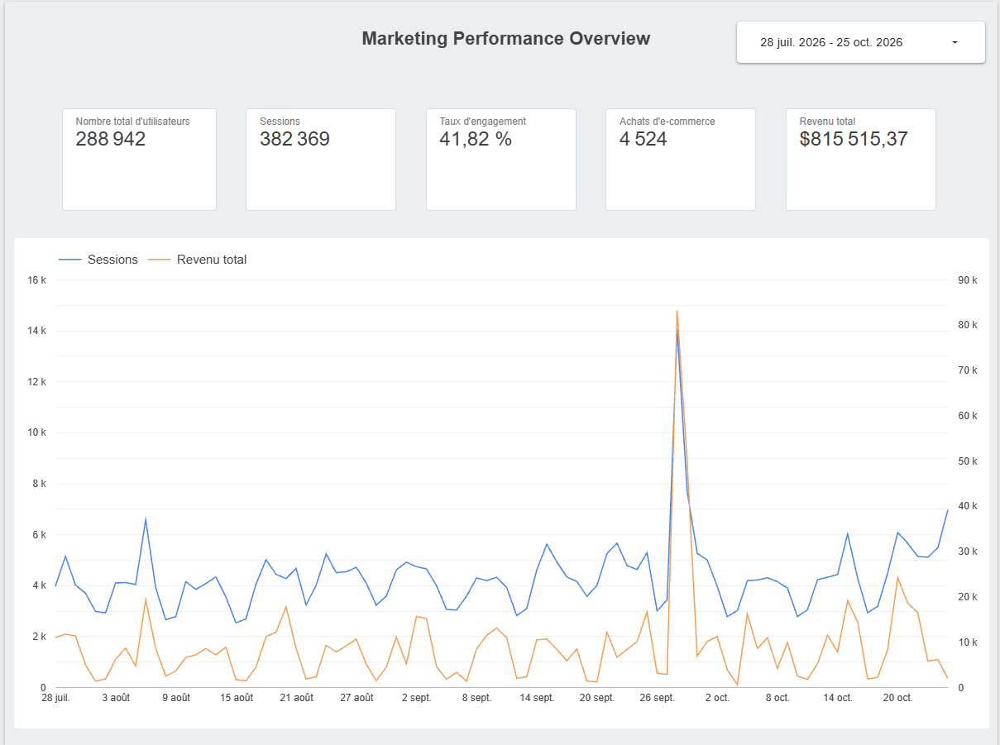
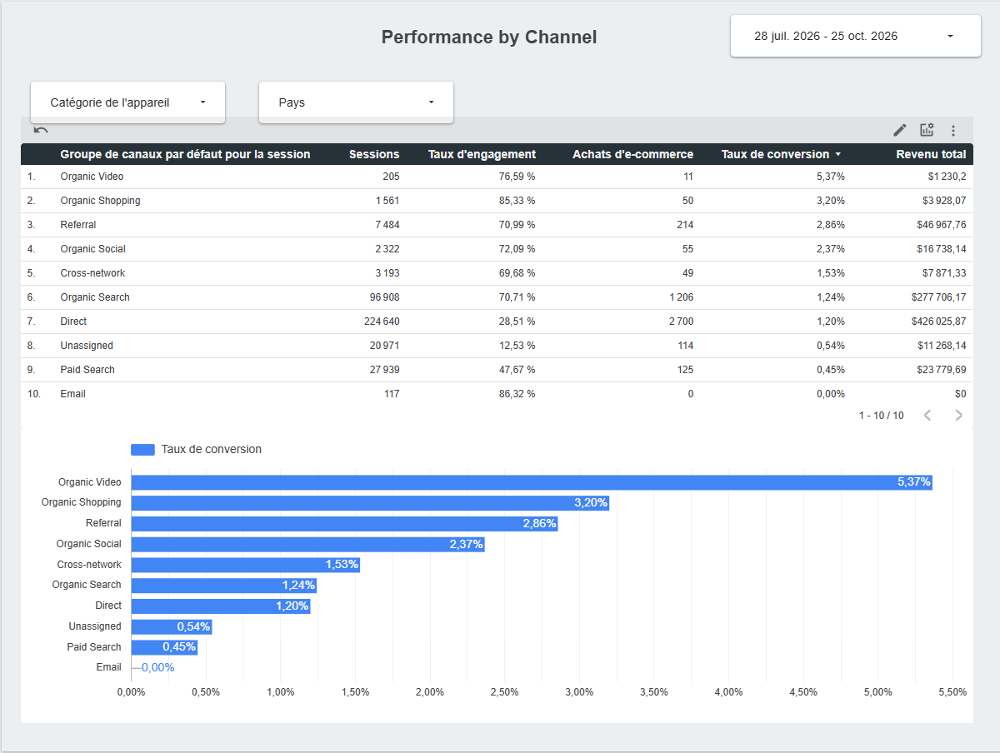
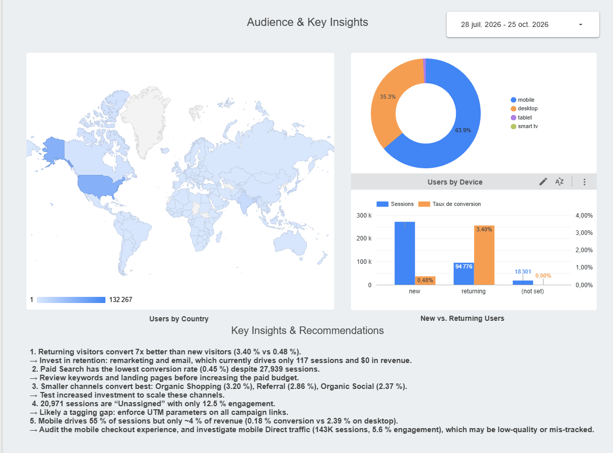

# Marketing Performance Dashboard – Google Merchandise Store

**Tools:** Looker Studio · Google Analytics 4 (GA4)
**Live dashboard:** [View the interactive report](https://datastudio.google.com/reporting/4933b658-ac5b-42c5-b643-eb6e1f8ad920)

## Overview

An interactive 3-page Looker Studio dashboard built on real e-commerce data from the
**Google Merchandise Store** (Google's official online shop, available through the GA4 demo account).
It analyzes **380,000+ sessions over 90 days** (Jul 28 – Oct 25, 2026) to answer one question:
*which channels, devices and audiences drive revenue, and where should the marketing budget go?*

## Dashboard pages

| Page | What it shows |
|---|---|
| **1. Overview** | KPI scorecards (users, sessions, engagement rate, purchases, revenue) and a daily trend of sessions vs. revenue on two axes |
| **2. Performance by Channel** | Channel table with sessions, engagement, purchases, a calculated **conversion rate** and revenue; conversion rate by channel; device and country filters |
| **3. Audience & Key Insights** | Users by country, users by device, new vs. returning users, and written recommendations |

## Screenshots

## Key insights & recommendations

1. **Mobile drives 55% of sessions but only ~4% of revenue** (0.18% conversion vs. 2.39% on desktop).
   → Audit the mobile checkout, and investigate mobile Direct traffic (143K sessions, 5.6% engagement), which may be low-quality or mis-tracked.
2. **Returning visitors convert 7x better than new visitors** (3.40% vs. 0.48%).
   → Invest in retention: remarketing and email, which currently drives only 117 sessions and $0 in revenue.
3. **Paid Search has the lowest conversion rate (0.45%) despite 27,939 sessions.**
   → Review keywords and landing pages before increasing paid spend.
4. **Smaller channels convert best:** Organic Shopping (3.20%), Referral (2.86%), Organic Social (2.37%).
   → Test increased investment to scale them.
5. **20,971 sessions are "Unassigned"** with 12.5% engagement.
   → Likely a tagging gap: enforce UTM parameters on all campaign links.

## Technical notes

- **Data source:** GA4 connector in Looker Studio (Google Merchandise Store demo property).
- **Calculated field:** `Conversion rate = Ecommerce purchases / Sessions`.
- **Dimension choice:** used *Session default channel group* (session-scoped) rather than *Default channel group* (event-scoped), so it can be combined with session metrics like Sessions and Engagement rate.
- **Date range:** the most recent days are excluded because GA4 data takes 24–48 hours to be fully processed.
